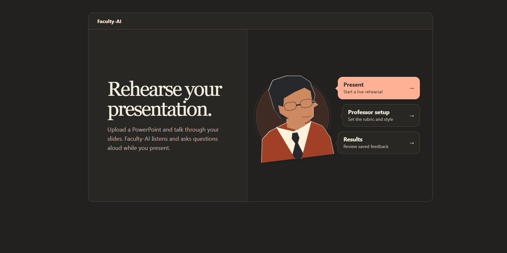
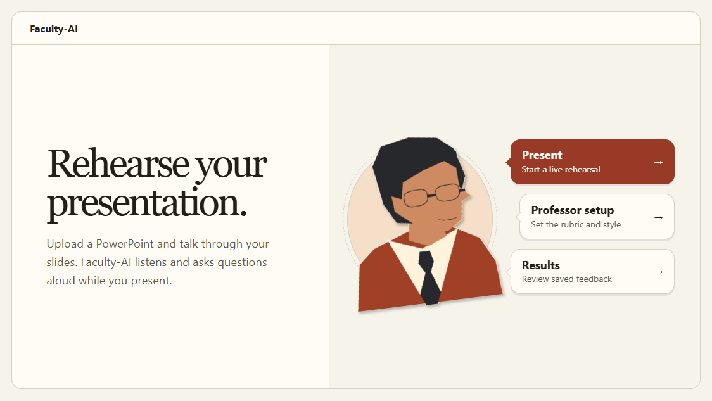
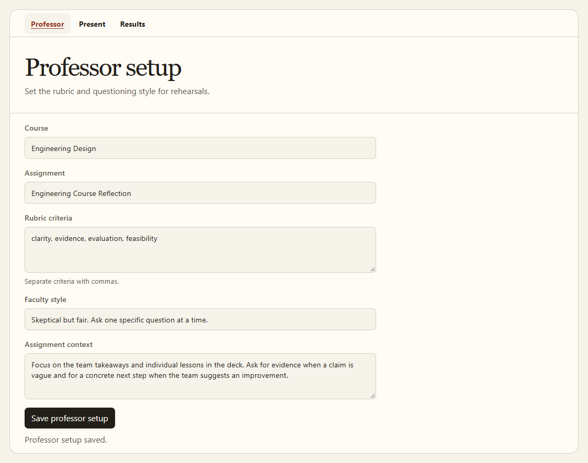
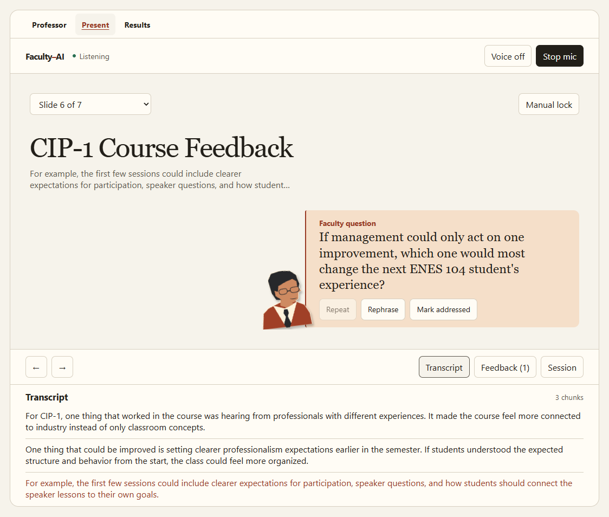
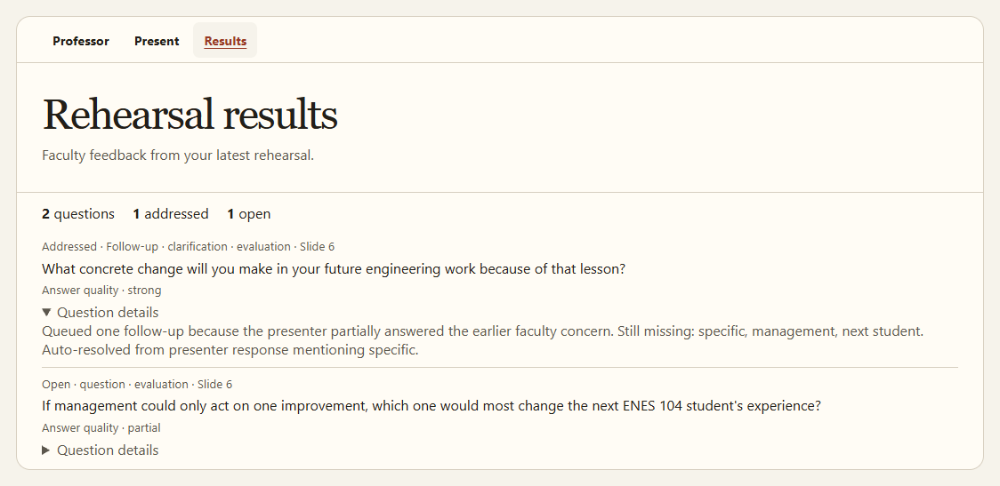
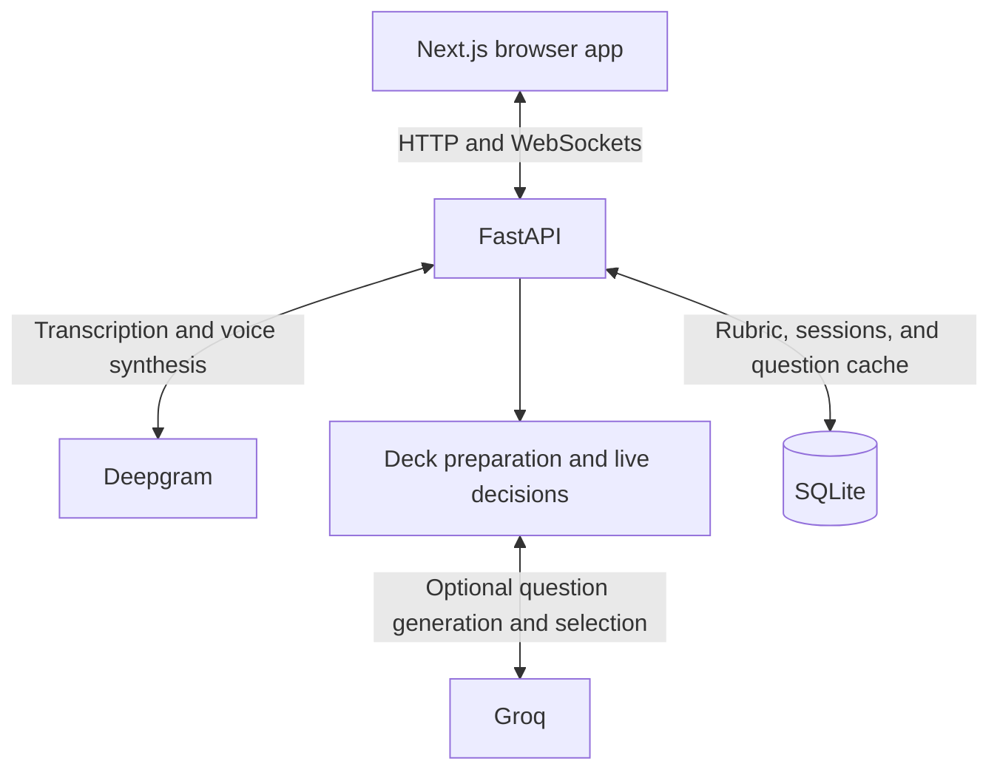

# Faculty-AI

Faculty-AI helps students rehearse academic presentations by following their PowerPoint slides, asking faculty-style questions aloud, and saving feedback for review.

[](docs/media/rehearsal-demo.gif)

*Open Present, drop in a PowerPoint, and see the first faculty question appear.*

[Sample PowerPoint](docs/sample-rehearsal.pptx) · [Architecture](#architecture) · [Run locally](#run-locally)

## Overview

Faculty questions are hard to anticipate when practicing alone. Faculty-AI prepares questions from the deck and assignment rubric, listens for what the presenter covers, and waits for an opening to ask about a specific gap. Afterward, the presenter can review which answers were strong and which questions remain open.

## Application tour

Select a screenshot to open it at full size.

| Home | Professor setup |
| :---: | :---: |
| [](docs/media/home.png) | [](docs/media/professor-setup.png) |
| Choose where to enter the rehearsal workflow. | Set the assignment context, rubric, and questioning style. |

<details>
<summary>Live rehearsal and transcript</summary>

[](docs/media/live-rehearsal.png)

*The live cockpit shows the active slide, question controls, and transcript together. This screenshot uses the sample deck and replayed transcript input.*

</details>

### Rehearsal results

[](docs/media/rehearsal-results.png)

*The latest rehearsal in this browser included a partial answer and a strong answer to its follow-up.*

## Features

- **PowerPoint upload.** Drop a `.pptx` onto the rehearsal stage to extract slide text, classify slides, and prepare questions from the configured rubric.
- **Microphone and slide tracking.** Stream a transcript from the microphone, follow the inferred slide, or use **Manual lock** to move through the deck.
- **Faculty questions and follow-ups.** See questions beside the CSS professor and hear them with voice enabled. Ask for a repeat or rephrase. A partial answer can prompt one follow-up.
- **Answer feedback.** The app records weak, partial, or strong ratings for responses to faculty questions. Presenters can address or reopen a question, and advancing in **Manual lock** addresses the on-screen question.
- **Saved rehearsal results.** Review the latest rehearsal’s questions, answer ratings, and open or addressed status from the same browser.

## Architecture



The browser sends microphone audio through the FastAPI speech proxy to Deepgram. It receives transcription events and submits finalized chunks with the active slide and recent context. FastAPI evaluates the latest answer or decides whether to ask, queue, or skip a question. When voice is enabled, a separate stream plays the question through the browser.

| Layer | Technologies |
| --- | --- |
| Frontend | Next.js 16, React 19, TypeScript, CSS Modules |
| Backend | Python, FastAPI, Pydantic, python-pptx |
| Speech | Deepgram streaming transcription and text-to-speech |
| Optional model integration | Groq with GPT-OSS for question preparation and selection, and Qwen for rephrasing |
| Storage and checks | SQLite and GitHub Actions |

### Engineering decisions

- **Ground questions in the current slide.** Deck preparation uses slide text and the professor’s rubric. During rehearsal, the engine compares prepared concerns with what the presenter has said, then applies warm-up, cooldown, and duplicate-question checks before interrupting. The default heuristic mode supports the rehearsal workflow without Groq. [Decision model](docs/how-it-thinks.md)
- **Keep rehearsal state consistent.** The frontend orders transcript analyses and question status updates for each session. Results waits for pending writes before loading the saved feedback. SQLite stores professor settings, sessions, and prepared questions.
- **Cache and replay.** Preparation is keyed by slide content, assignment context, and model configuration. A temporary provider failure can fall back to heuristics and leave the model-backed cache available. The replay harness feeds saved transcript chunks through the backend to exercise question timing and answer handling without a microphone. [Replay harness](docs/eval-harness.md)

## Run locally

Use **Python 3.11+** and **Node.js 20.9+**.

1. Create the backend virtual environment and install dependencies. From the repository root on Windows, run:

   ```powershell
   python -m venv backend/.venv
   .\backend\.venv\Scripts\python.exe -m pip install -r backend\requirements.txt
   npm --prefix frontend ci
   if (-not (Test-Path .env)) { Copy-Item .env.example .env }
   ```

   On macOS or Linux, run:

   ```bash
   python3 -m venv backend/.venv
   source backend/.venv/bin/activate
   python -m pip install -r backend/requirements.txt
   npm --prefix frontend ci
   if [ ! -f .env ]; then cp .env.example .env; fi
   ```

2. Set `DEEPGRAM_API_KEY` in the root `.env` for live transcription and spoken questions. To enable model-backed preparation and selection, also set `GROQ_API_KEY` and `FACULTY_AI_LLM_PROVIDER=groq`. [.env template](.env.example)
3. Run `npm run dev` from the repository root. Open <http://127.0.0.1:3000> and press Ctrl+C in the terminal when you’re done. The backend listens at `127.0.0.1:8000`, with health and API documentation endpoints. [Health check](http://127.0.0.1:8000/health) · [API docs](http://127.0.0.1:8000/docs)

To try it, open **Present**, upload the sample, and expand **Session** to see the prepared questions. Start the microphone and talk through a slide to try the live flow. [Download the seven-slide sample deck](docs/sample-rehearsal.pptx)

<details>
<summary>Configuration and access details</summary>

Restart both services after changing the root `.env`. A separately started frontend uses the root `.env` as a fallback to shell variables and frontend environment files such as `frontend/.env.local`. Set `NEXT_PUBLIC_*` values before building the frontend.

| Variable | Default | Purpose |
| --- | --- | --- |
| `DEEPGRAM_API_KEY` | Empty | Live transcription and spoken questions |
| `DEEPGRAM_MODEL` | `flux-general-en` | Transcription model |
| `DEEPGRAM_LANGUAGE` | `en-US` | Language for non-Flux models |
| `GROQ_API_KEY` | Empty | Model-backed features and question rephrasing |
| `FACULTY_AI_LLM_PROVIDER` | `heuristic` | Set to `groq` for model-backed preparation and selection |
| `FACULTY_AI_LLM_MODEL` | `openai/gpt-oss-120b` | Groq model for preparation and live question selection |
| `FACULTY_AI_REPHRASE_MODEL` | `qwen/qwen3.8-27b` | Groq model for question rephrasing |
| `NEXT_PUBLIC_API_BASE_URL` | `http://localhost:8000` | Backend URL used by the frontend |
| `FACULTY_AI_ALLOWED_ORIGINS` | `http://localhost:3000,http://127.0.0.1:3000` | Backend CORS allowlist |
| `FACULTY_AI_APP_API_KEY` | Empty | Backend key for non-local access |
| `NEXT_PUBLIC_FACULTY_AI_APP_API_KEY` | Empty | Key sent by the frontend |
| `FACULTY_AI_ACCESS_CODE` | Empty | Optional access prompt when the frontend starts separately |
| `FACULTY_AI_DB_PATH` | `faculty_ai.db` at the repo root | Override the SQLite location with an absolute path |

The launcher binds both services to loopback and skips the optional access-code prompt. With separate startup and non-local access, HTTP requests require `x-facultyai-key` and WebSocket clients can pass `?key=`. Browser-visible `NEXT_PUBLIC_*` values are bundled into the frontend. Keep provider keys in the backend environment. The optional access code is shared across the app.

The application and SQLite database run locally. Live speech sends audio to Deepgram. With Groq enabled, model-backed features may send slide text and transcript context to Groq.

</details>

## Checks and further reading

GitHub Actions runs the backend regression tests, frontend type check, and production build. To run the same checks locally on Windows:

```powershell
npm --prefix frontend run lint
npm --prefix frontend run build
Push-Location backend
.\.venv\Scripts\python.exe -m unittest discover -s tests
Pop-Location
```

- [Frontend](frontend/README.md) and [backend](backend/README.md) startup and debugging notes.
- [Offline replay](docs/eval-harness.md) to test the decision workflow against a saved scenario.
- [How Faculty-AI thinks](docs/how-it-thinks.md) for slide inference, answer evaluation, and question timing.

## Project status

Faculty-AI previously had a hosted deployment. The current version is intended for local use. The screenshots document the app from setup through saved results, and the source and sample deck are available for technical review.
